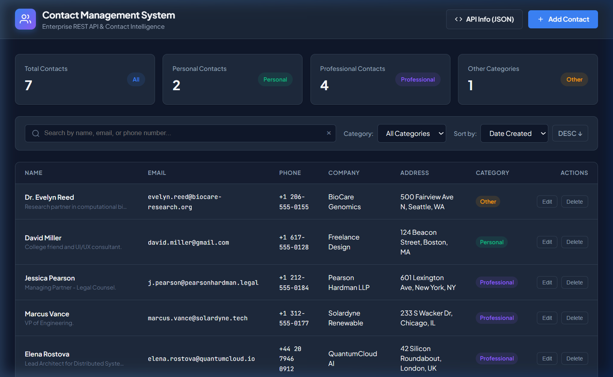
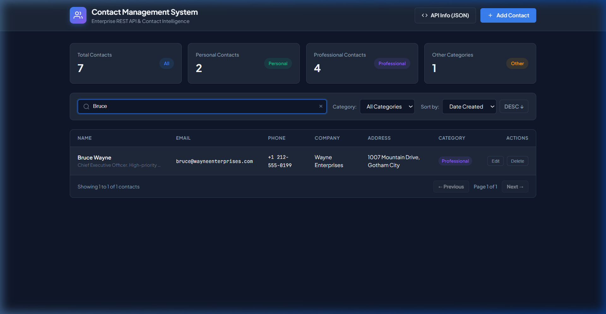
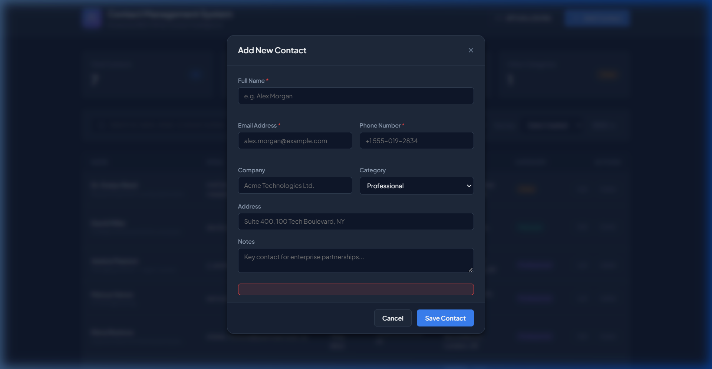
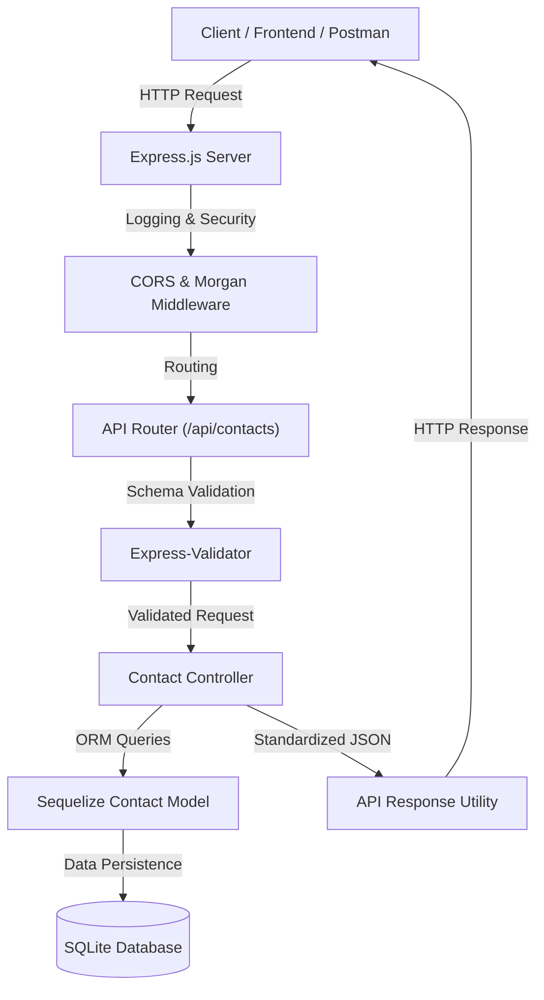
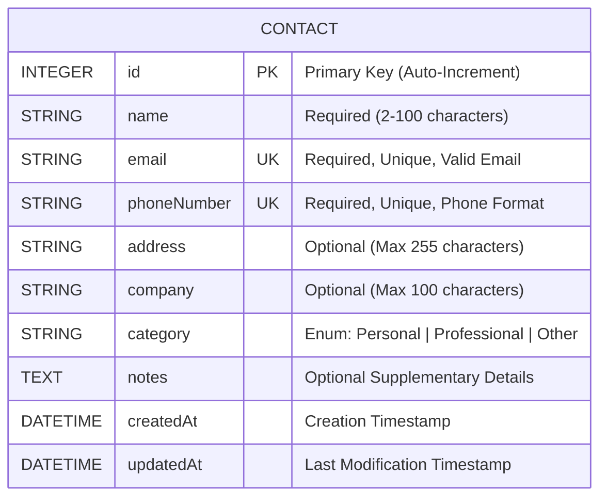

# Contact Management System REST API

A robust backend REST API application engineered to securely organize, search, and manage personal and professional contacts with database persistence, input validation, and real-time query capabilities.

---

## Application Preview & Screenshots

### Live Dashboard & Metrics


### Real-Time Search & Filtering


### Contact Creation & Validation Form


---

## Architecture & Request Flow



### Database Entity Relationship Diagram



---

## Features

- **Full Contact Lifecycle (CRUD)**: Create, retrieve, update, and delete contact entries with full record tracking.
- **Rich Contact Attributes**: Store contact name, email, phone number, address, company name, category classification (Personal / Professional / Other), and notes.
- **Search Engine**: Search across names, email addresses, and phone numbers via keyword queries.
- **Pagination & Sorting**: Paginate large contact registries with dynamic `limit`, `page`, `sortBy`, and `order` (ASC/DESC) parameters.
- **Input Validation & Sanitization**: Comprehensive field checks ensuring valid email formats, phone number structures, and trimmed strings.
- **Duplicate Prevention**: Rejects duplicate contact registrations (preventing collisions on email and phone number) with `409 Conflict` responses.
- **Centralized Error Handling**: Structured, informative JSON error payloads with accurate HTTP status codes.
- **Built-in Interactive Dashboard**: Responsive web client served directly from the backend to visually test and interact with the REST APIs.
- **Database Seeder**: Includes an automated seeding script to populate realistic contact datasets.
- **Automated Test Suite**: Integrated test runner covering all endpoints, validations, filtering, and edge cases.

---

## Tech Stack

| Layer | Technology |
|---|---|
| **Runtime** | Node.js |
| **Framework** | Express.js |
| **Database ORM** | Sequelize v6 |
| **Database Engine** | SQLite3 (Zero-configuration file-based storage) |
| **Validation** | Express-Validator |
| **Middleware** | CORS, Morgan (HTTP Request Logging) |

---

## Project Structure

```text
Contact Management System/
├── public/                       # Client dashboard for visual API interaction
│   ├── index.html                # Responsive web interface
│   ├── style.css                 # Custom styling
│   └── app.js                    # Client-side API integration
├── src/
│   ├── config/
│   │   └── database.js           # Sequelize connection & SQLite configuration
│   ├── controllers/
│   │   └── contactController.js  # Business logic (CRUD, search, pagination)
│   ├── middlewares/
│   │   ├── errorHandler.js       # Centralized error handler
│   │   ├── notFoundHandler.js    # 404 handler
│   │   └── validationHandler.js  # Validation results processor
│   ├── models/
│   │   ├── index.js              # Model registry & database synchronization
│   │   └── Contact.js            # Contact database schema
│   ├── routes/
│   │   ├── index.js              # Base API router
│   │   └── contactRoutes.js      # Contact resource endpoints
│   ├── utils/
│   │   └── apiResponse.js        # Standardized JSON response formatters
│   ├── validators/
│   │   └── contactValidator.js   # Request validation schemas
│   ├── app.js                    # Express application configuration
│   ├── server.js                 # Server entry point
│   └── seed.js                   # Database seeder script
├── tests/
│   └── api.test.js               # Comprehensive test suite
├── .env.example                  # Environment configuration template
├── .gitignore                    # Git ignore file
├── package.json                  # Dependencies and scripts
└── README.md                     # Documentation
```

---

## Quick Startup Guide

### Prerequisites

Ensure the following is installed on your workstation:
- **Node.js** (v18.0.0 or higher)
- **npm** (v9.0.0 or higher)

### 1. Installation

Clone the repository and install the project dependencies:

```bash
npm install
```

### 2. Environment Configuration

Copy the sample environment file to create your local `.env`:

```bash
cp .env.example .env
```

Default `.env` configuration:
```env
PORT=5000
NODE_ENV=development
DB_STORAGE=./data/contacts.sqlite
```

### 3. Seed Database (Optional)

To initialize the database with pre-configured personal and professional contact records:

```bash
npm run seed
```

### 4. Start the Application

To run in development mode with auto-reload:

```bash
npm run dev
```

To run in production mode:

```bash
npm start
```

Once running, access:
- **Web UI & Dashboard**: `http://localhost:5000`
- **REST API Endpoint**: `http://localhost:5000/api/contacts`
- **API Status & Info**: `http://localhost:5000/api`

---

## REST API Reference

### Endpoints Overview

| Method | Endpoint | Description | Status Code |
|---|---|---|---|
| `GET` | `/api` | Service health status and metadata | 200 OK |
| `GET` | `/api/contacts` | Retrieve contacts with pagination, search, and filters | 200 OK |
| `GET` | `/api/contacts/stats` | Retrieve aggregate counts by category | 200 OK |
| `GET` | `/api/contacts/:id` | Retrieve single contact by ID | 200 OK / 404 Not Found |
| `POST` | `/api/contacts` | Create a new contact | 201 Created / 400 Bad Request / 409 Conflict |
| `PUT` | `/api/contacts/:id` | Update an existing contact | 200 OK / 400 Bad Request / 409 Conflict |
| `DELETE` | `/api/contacts/:id` | Remove a contact record | 200 OK / 404 Not Found |

---

### Query Parameters for `GET /api/contacts`

| Parameter | Type | Default | Description | Example |
|---|---|---|---|---|
| `search` | String | - | Matches against `name`, `email`, or `phoneNumber` | `?search=Wayne` |
| `category` | String | - | Filter by category (`Personal`, `Professional`, `Other`) | `?category=Professional` |
| `company` | String | - | Filter by company name | `?company=Acme` |
| `page` | Integer | `1` | Page number | `?page=2` |
| `limit` | Integer | `10` | Records per page (Max: `100`) | `?limit=20` |
| `sortBy` | String | `createdAt` | Field to sort by (`name`, `email`, `company`, `category`, `createdAt`) | `?sortBy=name` |
| `order` | String | `DESC` | Sorting direction (`ASC` or `DESC`) | `?order=ASC` |

---

### Request & Response Examples

#### 1. Create Contact
- **Endpoint**: `POST /api/contacts`
- **Headers**: `Content-Type: application/json`

**Request Body**:
```json
{
  "name": "Sarah Connor",
  "email": "sarah.connor@cyberdyne.org",
  "phoneNumber": "+1 415-555-0142",
  "address": "8400 Sunset Blvd, Los Angeles, CA",
  "company": "Resistance Ops",
  "category": "Personal",
  "notes": "Emergency contact"
}
```

**Response (`201 Created`)**:
```json
{
  "success": true,
  "message": "Contact created successfully.",
  "data": {
    "id": 1,
    "name": "Sarah Connor",
    "email": "sarah.connor@cyberdyne.org",
    "phoneNumber": "+1 415-555-0142",
    "address": "8400 Sunset Blvd, Los Angeles, CA",
    "company": "Resistance Ops",
    "category": "Personal",
    "notes": "Emergency contact",
    "createdAt": "2026-10-20T13:30:00.000Z",
    "updatedAt": "2026-10-20T13:30:00.000Z"
  }
}
```

#### 2. Get Contacts with Pagination and Search
- **Endpoint**: `GET /api/contacts?search=Wayne&page=1&limit=10`

**Response (`200 OK`)**:
```json
{
  "success": true,
  "message": "Contacts retrieved successfully.",
  "data": [
    {
      "id": 2,
      "name": "Bruce Wayne",
      "email": "bruce@wayneenterprises.com",
      "phoneNumber": "+1 212-555-0199",
      "address": "1007 Mountain Drive, Gotham City",
      "company": "Wayne Enterprises",
      "category": "Professional",
      "notes": "Chief Executive Officer"
    }
  ],
  "meta": {
    "totalRecords": 1,
    "totalPages": 1,
    "currentPage": 1,
    "limit": 10,
    "hasNextPage": false,
    "hasPrevPage": false,
    "appliedFilters": {
      "search": "Wayne",
      "category": null,
      "company": null,
      "sortBy": "createdAt",
      "order": "DESC"
    }
  }
}
```

#### 3. Duplicate Prevention Response
- **Endpoint**: `POST /api/contacts` (Attempting to add duplicate email/phone)

**Response (`409 Conflict`)**:
```json
{
  "success": false,
  "message": "Duplicate contact: A contact with this email address already exists.",
  "errors": [
    {
      "field": "email",
      "message": "This email address is already registered."
    }
  ]
}
```

---

## Running the Automated Test Suite

Execute the integrated test suite:

```bash
npm test
```

The test runner operates on an isolated in-memory database to validate:
- Record creation, updates, and removals
- Input validation rejection rules
- Duplicate entry collision handling
- Keyword searches across names, emails, and phone numbers
- Sorting and multi-page pagination
- Aggregate metrics calculation
