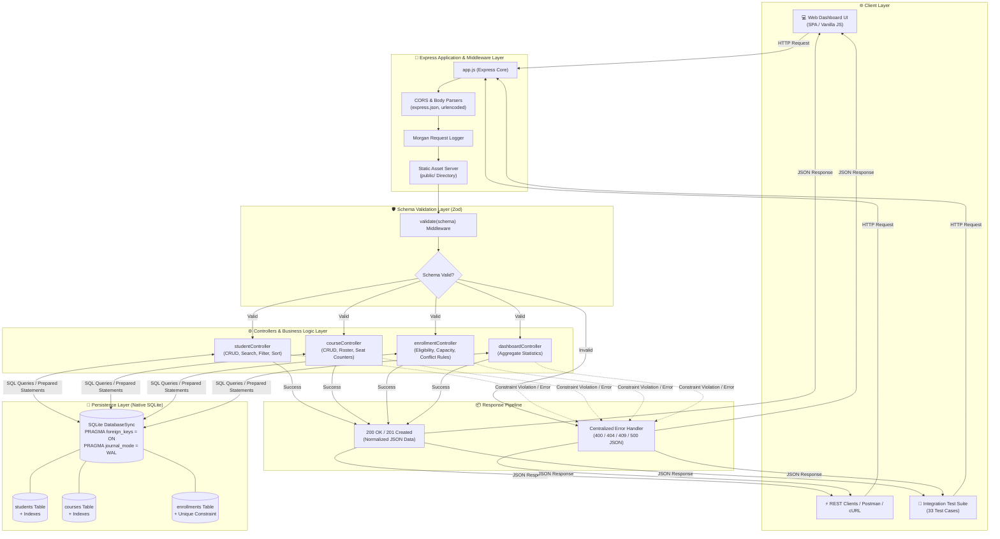
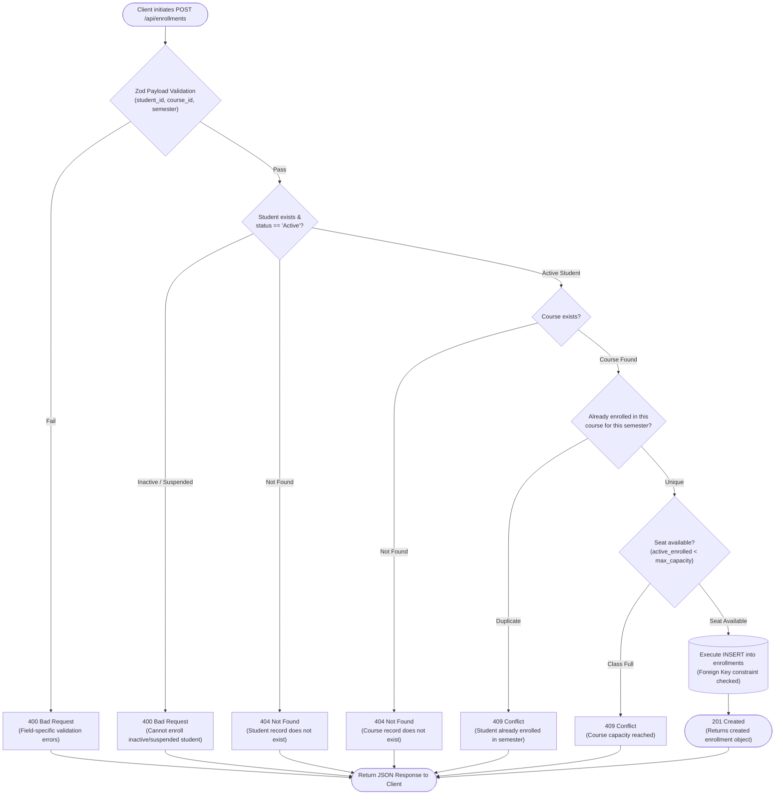
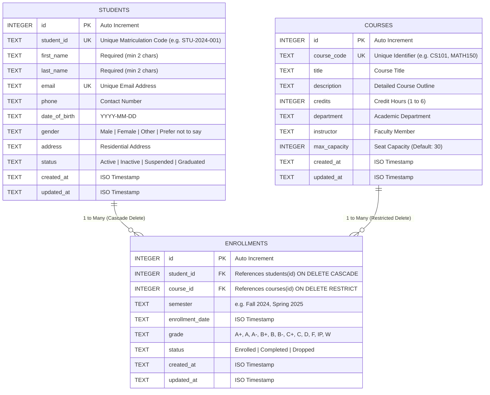

<div align="center">

# 🎓 Student Record Management RESTful API

[](https://nodejs.org/)
[](https://expressjs.com/)
[-003B57?logo=sqlite&logoColor=white)](https://www.sqlite.org/)
[](https://zod.dev/)
[](tests/runTests.js)
[](package.json)

<p align="center">
  A production-ready, modular RESTful backend application engineered to manage student academic records, course catalogs, and semester enrollments. Features relational database integrity, strict schema validation, multi-criteria filtering, sorting, pagination, an automated 33-case test suite, and an interactive in-browser API explorer.
</p>

[Key Features](#-key-features) •
[Architecture & Diagrams](#️-system-architecture--request-flow) •
[Relational Database](#-relational-database-design) •
[API Documentation](#-api-documentation) •
[Querying Engine](#-querying-engine-search-filter-sort-pagination) •
[Interactive Dashboard](#-interactive-web-dashboard--api-explorer) •
[Local Setup](#-quick-start-guide) •
[Testing](#-automated-testing-33-test-cases) •
[License](#-license)

---

</div>

## 🌟 Key Features

- **Relational Data Modeling**: Normalized schema for `Students`, `Courses`, and `Enrollments` with foreign keys, uniqueness constraints, cascading deletes, and performance indexes.
- **Complete CRUD REST APIs**: Clean endpoints adhering to RESTful standards with proper HTTP verbs (`GET`, `POST`, `PUT`, `PATCH`, `DELETE`).
- **Comprehensive Query Capabilities**:
  - 🔍 **Multi-Field Search**: Query across student names, student IDs, emails, course codes, and course titles.
  - 🎯 **Multi-Criteria Filtering**: Filter by enrollment status, gender, department, credit count, and academic semester.
  - 🔄 **Dynamic Sorting**: Whitelisted column sorting with ascending (`asc`) or descending (`desc`) ordering.
  - 📄 **Standardized Pagination**: Configurable `page` and `limit` parameters with complete pagination metadata (`totalRecords`, `totalPages`, `currentPage`, `hasNextPage`, `hasPrevPage`).
- **Strict Input Validation**: Every request payload and query parameter is validated using **Zod** schemas, returning descriptive `400 Bad Request` error responses on failure.
- **Referential Integrity & Relational Business Logic**:
  - Enforces unique enrollment per student, course, and semester (`409 Conflict`).
  - Validates course seat capacity before confirming enrollment (`409 Conflict`).
  - Restricts enrollment for inactive or suspended students (`400 Bad Request`).
  - Prevents accidental deletion of courses with active students (`409 Conflict`).
  - Cascades enrollments automatically when a student record is deleted.
- **Interactive Web Dashboard**: Built-in modern dark-mode frontend served at `http://localhost:5000` with real-time statistics cards, data tables, and a live API request runner.
- **Automated Test Suite**: 33 automated integration tests with 100% pass rate.

---

## 🏛️ System Architecture & Request Flow

The backend follows a layered architecture with distinct separation of concerns between HTTP transport, middleware, schema validation, business logic controllers, and SQLite storage.

### 1. Architectural Component Diagram



### 2. Request Lifecycle & Business Logic Flowchart (Enrollment Operation)

The flowchart below illustrates the defensive checks and business rules enforced when enrolling a student in a course (`POST /api/enrollments`):



---

## 🏗️ Relational Database Design

The database uses SQLite with Foreign Key enforcement (`PRAGMA foreign_keys = ON;`) and Write-Ahead Logging (`PRAGMA journal_mode = WAL;`) for data integrity and concurrency.



### Constraints & Indexes
- **`uq_student_course_semester`**: `UNIQUE(student_id, course_id, semester)` prevents enrolling a student multiple times in the same course within a single semester.
- **Indexes**: Dedicated B-tree indexes on `students(student_id)`, `students(email)`, `students(status)`, `courses(course_code)`, `courses(department)`, `enrollments(student_id)`, `enrollments(course_id)`, and `enrollments(semester)`.

---

## 📡 API Documentation

### Base URL: `http://localhost:5000`

### 1. Students Resource (`/api/students`)

| Method | Endpoint | Description | Query / Body Parameters | Status Codes |
|---|---|---|---|---|
| `GET` | `/api/students` | List students with search, filters, sort & pagination | `page`, `limit`, `search`, `status`, `gender`, `sortBy`, `sortOrder` | `200` |
| `GET` | `/api/students/:id` | Get student by ID with joined enrolled courses | None | `200`, `404` |
| `POST` | `/api/students` | Create new student record | `student_id`, `first_name`, `last_name`, `email`, `phone`, `date_of_birth`, `gender`, `address`, `status` | `201`, `400`, `409` |
| `PUT` | `/api/students/:id` | Full update of existing student | All student body fields | `200`, `400`, `404`, `409` |
| `PATCH` | `/api/students/:id` | Partial update of student | Any subset of student fields | `200`, `400`, `404`, `409` |
| `DELETE` | `/api/students/:id` | Delete student and cascade enrollments | None | `200`, `404` |

#### Sample Request: Create Student (`POST /api/students`)
```json
{
  "student_id": "STU-2024-042",
  "first_name": "Alexander",
  "last_name": "Wright",
  "email": "alex.wright@university.edu",
  "phone": "+1-555-0101",
  "date_of_birth": "2002-04-12",
  "gender": "Male",
  "address": "124 College Ave, Boston, MA",
  "status": "Active"
}
```

#### Sample Response (`201 Created`):
```json
{
  "success": true,
  "message": "Student record created successfully.",
  "data": {
    "id": 1,
    "student_id": "STU-2024-042",
    "first_name": "Alexander",
    "last_name": "Wright",
    "email": "alex.wright@university.edu",
    "phone": "+1-555-0101",
    "date_of_birth": "2002-04-12",
    "gender": "Male",
    "address": "124 College Ave, Boston, MA",
    "status": "Active",
    "created_at": "2026-10-16 16:38:39",
    "updated_at": "2026-10-16 16:38:39"
  }
}
```

---

### 2. Courses Resource (`/api/courses`)

| Method | Endpoint | Description | Query / Body Parameters | Status Codes |
|---|---|---|---|---|
| `GET` | `/api/courses` | List courses with active student count | `page`, `limit`, `search`, `department`, `credits`, `sortBy`, `sortOrder` | `200` |
| `GET` | `/api/courses/:id` | Get course details with enrolled students roster | None | `200`, `404` |
| `POST` | `/api/courses` | Create new course | `course_code`, `title`, `description`, `credits`, `department`, `instructor`, `max_capacity` | `201`, `400`, `409` |
| `PUT` | `/api/courses/:id` | Full update of course record | All course fields | `200`, `400`, `404`, `409` |
| `PATCH` | `/api/courses/:id` | Partial update of course | Any subset of course fields | `200`, `400`, `404`, `409` |
| `DELETE` | `/api/courses/:id` | Delete course (rejects if active enrollments exist) | None | `200`, `404`, `409` |

#### Sample Response: Course Details with Roster (`GET /api/courses/1`)
```json
{
  "success": true,
  "message": "Course retrieved successfully.",
  "data": {
    "id": 1,
    "course_code": "CS101",
    "title": "Introduction to Computer Science",
    "description": "Fundamental concepts of programming and algorithms.",
    "credits": 4,
    "department": "Computer Science",
    "instructor": "Dr. Alan Turing",
    "max_capacity": 40,
    "active_enrolled_count": 5,
    "available_seats": 35,
    "students": [
      {
        "enrollment_id": 1,
        "student_db_id": 1,
        "student_id": "STU-2024-001",
        "first_name": "Alexander",
        "last_name": "Wright",
        "email": "alex.wright@university.edu",
        "semester": "Fall 2024",
        "grade": "A",
        "enrollment_status": "Completed"
      }
    ]
  }
}
```

---

### 3. Enrollments Resource (`/api/enrollments`)

| Method | Endpoint | Description | Query / Body Parameters | Status Codes |
|---|---|---|---|---|
| `GET` | `/api/enrollments` | List enrollments with joined student & course info | `page`, `limit`, `search`, `student_id`, `course_id`, `semester`, `status`, `grade` | `200` |
| `GET` | `/api/enrollments/:id` | Get enrollment record by ID | None | `200`, `404` |
| `POST` | `/api/enrollments` | Enroll student into a course | `student_id`, `course_id`, `semester`, `grade`, `status` | `201`, `400`, `404`, `409` |
| `PATCH` | `/api/enrollments/:id` | Update enrollment status, grade, or semester | `grade`, `status`, `semester` | `200`, `400`, `404` |
| `DELETE` | `/api/enrollments/:id` | Drop / remove enrollment record | None | `200`, `404` |

#### Sample Request: Enroll Student (`POST /api/enrollments`)
```json
{
  "student_id": 2,
  "course_id": 3,
  "semester": "Spring 2025",
  "grade": "IP",
  "status": "Enrolled"
}
```

---

### 4. System & Analytics Endpoints

| Method | Endpoint | Description | Status Codes |
|---|---|---|---|
| `GET` | `/api/health` | System health, server uptime, environment, and version | `200` |
| `GET` | `/api/dashboard/stats` | Aggregate metrics (students, courses, enrollments, department breakdown) | `200` |

---

## 🔍 Querying Engine: Search, Filter, Sort, Pagination

All collection endpoints (`/api/students`, `/api/courses`, `/api/enrollments`) support query composition:

### 1. Multi-Field Search
```http
GET /api/students?search=Alexander
GET /api/courses?search=Computer
GET /api/enrollments?search=CS101
```

### 2. Multi-Criteria Filtering
```http
GET /api/students?status=Active&gender=Female
GET /api/courses?department=Computer%20Science&credits=4
GET /api/enrollments?semester=Fall%202024&status=Completed
```

### 3. Dynamic Sorting
```http
GET /api/students?sortBy=last_name&sortOrder=asc
GET /api/courses?sortBy=credits&sortOrder=desc
GET /api/enrollments?sortBy=enrollment_date&sortOrder=desc
```

### 4. Structured Pagination
```http
GET /api/students?page=1&limit=5
```
Response includes pagination metadata:
```json
{
  "success": true,
  "data": [ /* 5 items */ ],
  "pagination": {
    "totalRecords": 10,
    "totalPages": 2,
    "currentPage": 1,
    "limit": 5,
    "hasNextPage": true,
    "hasPrevPage": false
  }
}
```

---

## ⚡ Error Handling & HTTP Status Codes

The API returns consistent, descriptive JSON error structures across all routes:

```json
{
  "success": false,
  "message": "Validation failed for request data.",
  "errors": [
    { "field": "email", "message": "email must be a valid email address" },
    { "field": "first_name", "message": "first_name must be at least 2 characters" }
  ]
}
```

| HTTP Status Code | Meaning | Example Trigger |
|---|---|---|
| `200 OK` | Request succeeded | Record retrieved, updated, or deleted |
| `201 Created` | Resource created | Student created, course added, student enrolled |
| `400 Bad Request` | Validation or logic error | Invalid email syntax, credits > 6, enrolling suspended student |
| `404 Not Found` | Resource missing | Student ID or course ID does not exist |
| `409 Conflict` | Unique constraint / capacity violation | Duplicate student ID/email, duplicate enrollment, course full |
| `500 Server Error` | Unhandled error | Unexpected internal server exception |

---

## 🖥️ Interactive Web Dashboard & API Explorer

The application includes an in-browser interface served directly by the Express server at **`http://localhost:5000`**:

1. **System Overview**: Live metric widgets for total students, courses, active enrollments, total credit hours, department breakdown, and recent enrollment feed.
2. **Interactive Live API Explorer**: Test any endpoint (`GET`, `POST`, `PUT`, `PATCH`, `DELETE`) with pre-populated presets or custom JSON payloads. Displays status code badges and millisecond latency timers.
3. **Students Directory**: Interactive table with real-time search, status/gender filtering, pagination, and a modal view of enrolled courses.
4. **Courses Catalog**: Visual card grid showing instructor names, credit hours, and live seat fill ratios (`enrolled / capacity`).
5. **Enrollments Ledger**: Complete academic history with grade tracking and drop enrollment actions.
6. **Built-in Documentation**: In-app endpoint reference.

---

## 📁 Project Directory Structure

```
Student Record Management API/
├── .env.example              # Environment variables template
├── .gitignore                # Git ignore rules
├── LICENSE                   # ISC License
├── package.json              # Package manifest and npm scripts
├── README.md                 # Project documentation
├── src/
│   ├── app.js                # Express app configuration & middleware
│   ├── server.js             # HTTP server entry point
│   ├── config/
│   │   ├── env.js            # Environment configuration
│   │   └── db.js             # SQLite DatabaseSync connection & helper methods
│   ├── database/
│   │   ├── schema.sql        # Relational schema (DDL)
│   │   ├── initDb.js         # Schema runner script
│   │   └── seed.js           # Database seeder script
│   ├── middleware/
│   │   ├── validate.js       # Zod schema validation middleware
│   │   ├── errorHandler.js   # Centralized error handler
│   │   └── notFoundHandler.js# 404 handler for undefined routes
│   ├── validators/
│   │   ├── studentValidator.js    # Student validation schemas
│   │   ├── courseValidator.js     # Course validation schemas
│   │   └── enrollmentValidator.js # Enrollment validation schemas
│   ├── controllers/
│   │   ├── studentController.js   # Student business logic
│   │   ├── courseController.js    # Course business logic
│   │   ├── enrollmentController.js# Enrollment business logic
│   │   └── dashboardController.js # Analytics & stats logic
│   ├── routes/
│   │   ├── studentRoutes.js       # Student API routes
│   │   ├── courseRoutes.js        # Course API routes
│   │   ├── enrollmentRoutes.js    # Enrollment API routes
│   │   └── dashboardRoutes.js     # Dashboard API routes
│   └── public/               # Frontend assets
│       ├── index.html        # Interactive dashboard HTML
│       ├── styles.css        # Modern dark-mode stylesheet
│       └── app.js            # Dashboard interactive scripts
└── tests/
    ├── runTests.js           # Automated test suite (33 test cases)
    └── api.test.js           # Node.js native test runner integration
```

---

## 🚀 Quick Start Guide

### 1. Prerequisites
- **Node.js**: v18.0.0 or higher (tested on Node v24)
- **npm**: v9.0.0 or higher
- **Git**

### 2. Installation
```bash
# Clone the repository
git clone <your-repository-url>
cd "<repo-directory>/Student Record Management API"

# Install dependencies
npm install
```

### 3. Initialize & Seed Database
```bash
# Creates tables, constraints, indexes, and loads sample data
npm run seed
```

### 4. Start the Application
```bash
# Production mode
npm start

# Development mode (with auto-reload)
npm run dev
```

The server will start on **`http://localhost:5000`**. Open this URL in your web browser to access the dashboard and interactive API explorer.

---

## 🧪 Automated Testing (33 Test Cases)

To execute the test suite:

```bash
npm test
```

### Test Suite Execution Summary:

```text
========================================================================
   STUDENT RECORD MANAGEMENT API — AUTOMATED TEST SUITE EXECUTION       
========================================================================

🔄 Resetting and seeding test database...
✅ Database schema initialized successfully.
🌱 Seeding database...
✅ Seeded: 10 students, 8 courses, and 17 enrollments.
✔ Database ready for testing.

▶ SUITE 1: System Health & Info
  ✔ PASS [TC01] GET    /api/health                         Status: 200 (48ms)

▶ SUITE 2: Student Record Management & Validations
  ✔ PASS [TC02] POST   /api/students                       Status: 201 (28ms)
  ✔ PASS [TC03] POST   /api/students                       Status: 400 (6ms)
  ✔ PASS [TC04] POST   /api/students                       Status: 409 (5ms)
  ✔ PASS [TC05] POST   /api/students                       Status: 409 (4ms)
  ✔ PASS [TC06] GET    /api/students?page=1&limit=5        Status: 200 (5ms)
  ✔ PASS [TC07] GET    /api/students?search=Alexander      Status: 200 (4ms)
  ✔ PASS [TC08] GET    /api/students?status=Active&gender=Female Status: 200 (4ms)
  ✔ PASS [TC09] GET    /api/students?sortBy=last_name&sortOrder=asc Status: 200 (4ms)
  ✔ PASS [TC10] GET    /api/students/1                     Status: 200 (4ms)
  ✔ PASS [TC11] GET    /api/students/99999                 Status: 404 (3ms)
  ✔ PASS [TC12] PATCH  /api/students/11                    Status: 200 (10ms)
  ✔ PASS [TC13] DELETE /api/students/11                    Status: 200 (8ms)

▶ SUITE 3: Course Catalog Management & Validations
  ✔ PASS [TC14] POST   /api/courses                        Status: 201 (11ms)
  ✔ PASS [TC15] POST   /api/courses                        Status: 400 (6ms)
  ✔ PASS [TC16] POST   /api/courses                        Status: 409 (5ms)
  ✔ PASS [TC17] GET    /api/courses                        Status: 200 (5ms)
  ✔ PASS [TC18] GET    /api/courses?department=Computer%20Science Status: 200 (6ms)
  ✔ PASS [TC19] GET    /api/courses/1                      Status: 200 (5ms)
  ✔ PASS [TC20] PATCH  /api/courses/9                      Status: 200 (10ms)
  ✔ PASS [TC21] DELETE /api/courses/1                      Status: 409 (5ms)

▶ SUITE 4: Enrollment Operations & Relational Integrity
  ✔ PASS [TC22] POST   /api/enrollments                    Status: 201 (8ms)
  ✔ PASS [TC23] POST   /api/enrollments                    Status: 409 (5ms)
  ✔ PASS [TC24] POST   /api/enrollments                    Status: 400 (5ms)
  ✔ PASS [TC25] POST   /api/enrollments                    Status: 404 (4ms)
  ✔ PASS [TC26] POST   /api/enrollments                    Status: 404 (4ms)
  ✔ PASS [TC27] GET    /api/enrollments                    Status: 200 (7ms)
  ✔ PASS [TC28] GET    /api/enrollments?semester=Fall%202024&status=Completed Status: 200 (4ms)
  ✔ PASS [TC29] PATCH  /api/enrollments/18                 Status: 200 (8ms)
  ✔ PASS [TC30] DELETE /api/enrollments/18                 Status: 200 (7ms)
  ✔ PASS [TC31] DELETE /api/courses/9                      Status: 200 (7ms)

▶ SUITE 5: Analytics Dashboard & Catch-all Routing
  ✔ PASS [TC32] GET    /api/dashboard/stats                Status: 200 (4ms)
  ✔ PASS [TC33] GET    /api/unknown-endpoint-xyz           Status: 404 (4ms)

========================================================================
TEST SUITE SUMMARY:
  Total Test Cases: 33
  Passed:           33
  Failed:           0
  Success Rate:     100%
========================================================================
```

---

## 📄 License

This project is licensed under the [ISC License](LICENSE).
