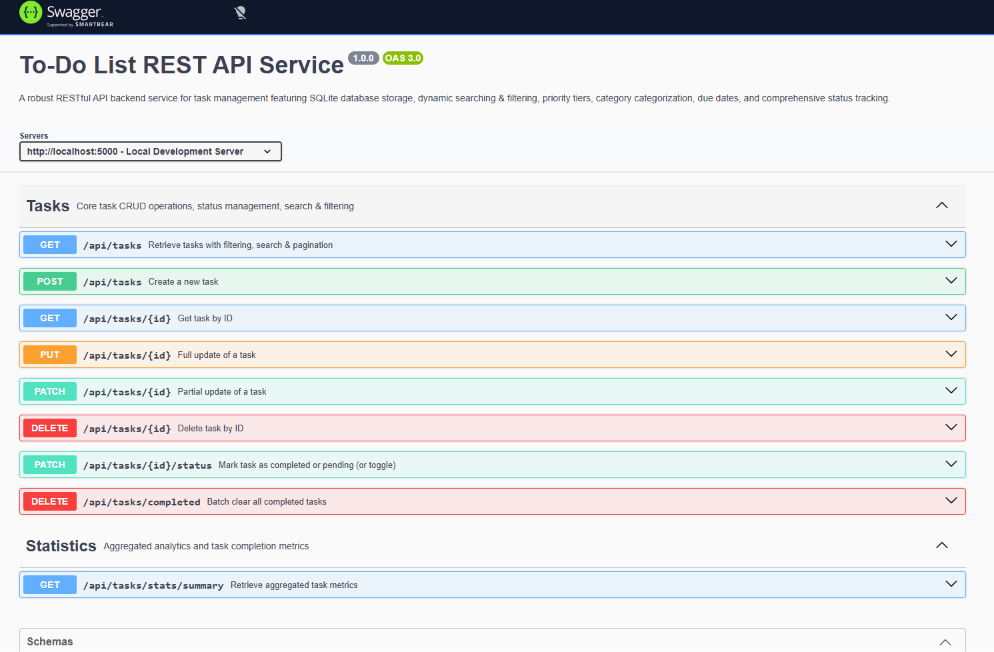
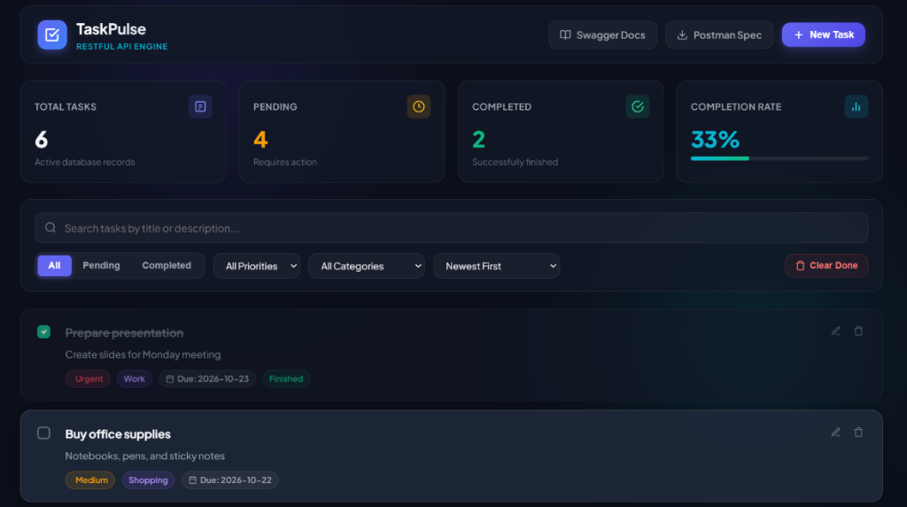
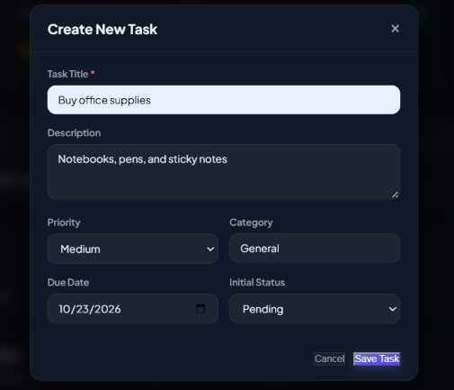
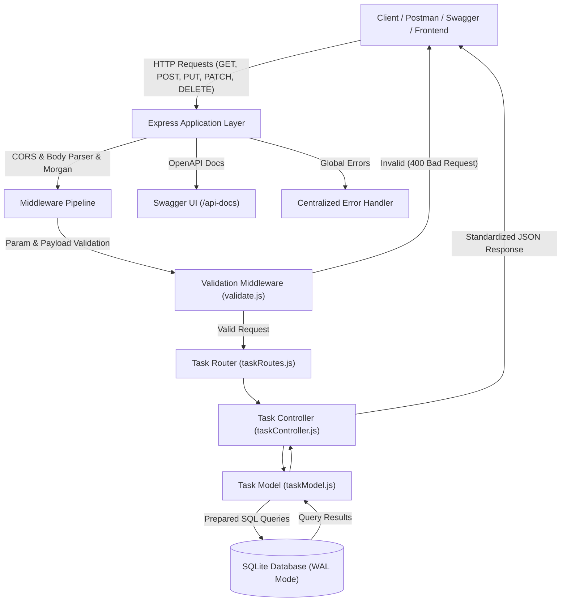

# TaskPulse - To-Do List Backend REST API

A robust, production-grade RESTful API backend service designed for task management and workflow tracking. Built with Node.js, Express, and SQLite, the service provides high-performance data persistence, strict request validation, comprehensive search and filtering capabilities, and interactive API documentation via Swagger OpenAPI 3.0 and Postman.

---

## Application & Documentation Preview

### Interactive Swagger UI API Documentation


### Task Management Dashboard


### Task Creation & Metadata Modal


---

## Architecture & System Flow

The service follows a layered architectural pattern separating concerns across routing, request validation, business logic controllers, database modeling, and centralized error handling.



---

## Core Features

- **Full RESTful CRUD Operations**: Create, read, update, delete, and batch manage tasks.
- **Completion Status Management**: Toggle tasks between `pending` and `completed` with automatic tracking of `completed_at` timestamps.
- **Relational SQLite Persistence**: Fast file-backed database storage with Write-Ahead Logging (WAL) and indexed columns for fast queries.
- **Data Validation & Sanitization**: Strict schema validation on headers, path parameters, query strings, and JSON request bodies before reaching controller logic.
- **Uniform HTTP Status Codes**: Explicit adherence to standard HTTP codes (`200 OK`, `201 Created`, `400 Bad Request`, `404 Not Found`, `500 Internal Server Error`).
- **Flexible Searching & Filtering**:
  - Filter by completion status (`pending`, `completed`, `all`)
  - Filter by priority tier (`low`, `medium`, `high`, `urgent`)
  - Filter by category name
  - Full-text search across titles and descriptions
  - Multi-field sorting (`created_at`, `due_date`, `priority`, `title`) in `asc` or `desc` order
  - Configurable pagination (`page`, `limit`)
- **Aggregated Analytics & Metrics**: Dedicated endpoint providing total task volume, status distribution, overdue count, completion rate percentage, and category breakdowns.
- **Dual API Documentation**:
  - Interactive Swagger UI documentation at `/api-docs`
  - Exported Postman collection (`postman_collection.json`) ready for single-click import
- **Automated Integration Test Suite**: 19 comprehensive automated test cases validating status codes, input boundaries, and error handlers.

---

## Technology Stack

- **Runtime**: Node.js (v18+)
- **Framework**: Express.js
- **Database Engine**: SQLite via `better-sqlite3` (WAL mode enabled)
- **Documentation**: Swagger UI Express (`swagger-ui-express`, `swagger-jsdoc`), OpenAPI 3.0.3, Postman Collection v2.1
- **Logging**: Morgan HTTP logger
- **Testing**: Node.js Native Test Runner (`node:test`, `node:assert/strict`)

---

## Database Schema

The SQLite schema utilizes constraints and optimized indexes:

| Column | Type | Constraints | Description |
| :--- | :--- | :--- | :--- |
| `id` | INTEGER | PRIMARY KEY AUTOINCREMENT | Unique task identifier |
| `title` | TEXT | NOT NULL | Task title (1–200 characters) |
| `description` | TEXT | NULLABLE | Detailed task description |
| `status` | TEXT | DEFAULT 'pending' | Status: `pending` or `completed` |
| `priority` | TEXT | DEFAULT 'medium' | Priority tier: `low`, `medium`, `high`, `urgent` |
| `category` | TEXT | DEFAULT 'General' | Organizational category label |
| `due_date` | TEXT | NULLABLE | Target completion date (YYYY-MM-DD or ISO 8601) |
| `completed_at` | TEXT | NULLABLE | Timestamp recorded upon task completion |
| `created_at` | TEXT | DEFAULT (datetime('now')) | Record creation timestamp |
| `updated_at` | TEXT | DEFAULT (datetime('now')) | Last update timestamp |

Database indexes are established on `status`, `priority`, `category`, `due_date`, and `created_at` for high-throughput query performance.

---

## API Endpoints Reference

### Tasks

| Method | Endpoint | Query / Path Parameters | Description | Status Code |
| :--- | :--- | :--- | :--- | :--- |
| `GET` | `/api/tasks` | `status`, `priority`, `category`, `search`, `sortBy`, `order`, `page`, `limit` | Retrieve tasks with filtering and pagination | `200 OK` |
| `POST` | `/api/tasks` | Request Body (`title` required, `description`, `priority`, `category`, `due_date`) | Create a new task | `201 Created` |
| `GET` | `/api/tasks/:id` | `:id` (positive integer) | Retrieve a single task by ID | `200 OK` / `404 Not Found` |
| `PUT` | `/api/tasks/:id` | `:id`, Request Body | Full update of task details | `200 OK` / `400 Bad Request` / `404 Not Found` |
| `PATCH` | `/api/tasks/:id` | `:id`, Request Body | Partial update of task fields | `200 OK` / `400 Bad Request` / `404 Not Found` |
| `PATCH` | `/api/tasks/:id/status`| `:id`, Optional Body `{ "status": "completed" }` | Mark task completed / pending or toggle status | `200 OK` / `404 Not Found` |
| `DELETE`| `/api/tasks/:id` | `:id` (positive integer) | Delete task by ID | `200 OK` / `404 Not Found` |
| `DELETE`| `/api/tasks/completed` | None | Batch delete all completed tasks | `200 OK` |

### Statistics & Health

| Method | Endpoint | Description | Status Code |
| :--- | :--- | :--- | :--- |
| `GET` | `/api/tasks/stats/summary` | Summary metrics (totals, completion rate, priority and category breakdown) | `200 OK` |
| `GET` | `/health` | Server health check and uptime monitor | `200 OK` |
| `GET` | `/api-docs` | Interactive Swagger UI API documentation | `200 OK` |
| `GET` | `/api-docs.json` | Raw OpenAPI 3.0.3 JSON schema | `200 OK` |

---

## Quick Startup Guide

### Prerequisites

- Node.js (v18.0.0 or higher)
- npm (v9.0.0 or higher)

### Installation

1. Navigate to the project directory:
   ```bash
   cd "To-Do List Backend"
   ```

2. Install dependencies:
   ```bash
   npm install
   ```

3. Configure Environment Variables (optional, defaults provided):
   ```bash
   cp .env.example .env
   ```
   Default configuration:
   ```env
   PORT=5000
   NODE_ENV=development
   DB_PATH=./data/tasks.db
   ```

### Starting the Server

- **Production Mode**:
  ```bash
  npm start
  ```

- **Development Mode** (with automatic file watching):
  ```bash
  npm run dev
  ```

The server will initialize the SQLite database automatically and listen on:
```
http://localhost:5000
```

### Running Automated Tests

Execute the comprehensive test suite:
```bash
npm test
```

All 19 test cases will run against an isolated ephemeral server instance and verify:
- API health and OpenAPI specification validity
- Full CRUD cycle for tasks
- Validation error handling and 400 Bad Request responses
- 404 Not Found handling for non-existent IDs
- Filter queries (`status=completed`, `status=pending`, `priority=high`, `search=...`)
- Status toggle transitions and timestamp recording
- Batch operations and analytics calculations

---

## Interactive Documentation & Postman

- **Swagger UI**: Open `http://localhost:5000/api-docs` in any web browser to explore, test, and execute requests interactively with live parameter inputs.
- **Postman Collection**: Import `postman_collection.json` located in the root of the project directly into Postman to access pre-configured request templates for all endpoints.

---

## License

This project is licensed under the MIT License - see the [LICENSE](LICENSE) file for details.
